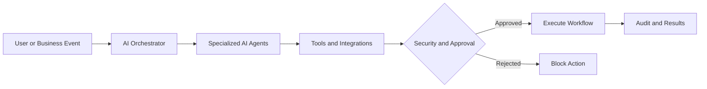

# Desmond MacAuley

### Agentic AI | Multi-Agent Systems | AI Automation | DevSecOps | Cloud Architecture | Database Engineering

I build secure infrastructure and AI-powered products that turn complex workflows into reliable, intelligent systems.

With **10+ years of experience in enterprise technology**, my background spans DevSecOps, cloud engineering, cybersecurity, Kubernetes, automation, and Oracle database administration.

Today, I combine that foundation with **Agentic AI, Multi-Agent Systems, Generative AI, intelligent automation, and AI-powered application development** to build software that can reason, coordinate tasks, interact with tools, and assist people with real-world work.

---

## About Me

I'm a DevSecOps, cloud, and AI systems engineer focused on developing secure, scalable technology and intelligent software products.

My experience includes:

- Designing and maintaining enterprise CI/CD pipelines.
- Implementing automated application security and vulnerability management.
- Architecting and securing AWS and Azure environments.
- Deploying and managing containerized applications with Docker and Kubernetes.
- Building infrastructure automation with Terraform and Ansible.
- Administering enterprise Oracle databases and high-availability systems.
- Developing AI-powered applications and intelligent automation workflows.
- Designing agentic AI architectures and multi-agent coordination patterns.
- Integrating AI capabilities into business processes and software products.

I focus on turning complex technical challenges into practical, secure, and maintainable solutions.

---

## AI, Agentic Systems & Intelligent Automation

My current development work explores and implements AI capabilities across software products, business processes, and operational workflows.

### Agentic AI Development

- AI agents with specialized roles and responsibilities.
- Tool calling and external API integration.
- Task planning, reasoning, and workflow execution.
- Context management and persistent application state.
- Event-driven agent workflows.
- Human approval and intervention.
- Secure access to enterprise systems and business data.

### Multi-Agent Systems

- Coordinating multiple specialized AI agents.
- Agent-to-agent communication and task handoffs.
- Orchestration of complex business workflows.
- Distributed task execution and dependency management.
- Shared context and coordinated decision-making.
- Monitoring, logging, and auditing agent activity.
- Human-in-the-loop governance and execution controls.

### Generative AI & Multimodal Applications

- Large Language Model integration.
- AI-powered conversational interfaces.
- Voice-enabled assistants.
- Document processing and intelligent data extraction.
- Image and text understanding.
- AI-assisted reporting and content generation.
- Structured responses and workflow automation.

### AI Security & Governance

- Least-privilege access for AI tools and agents.
- Human approval for sensitive actions.
- Secure API integration and credential management.
- Audit trails and execution monitoring.
- Prompt-injection and unauthorized-action safeguards.
- Data privacy and tenant isolation.
- Usage limits, cost monitoring, and policy enforcement.

---

## AI & Agentic Technology Stack

---

## Personal Projects & Products

### PROFILE — AI-Enhanced Social Platform

Building a social platform designed around personal expression, creative ownership, and user-controlled digital spaces.

**Core product areas:**
- Your World — customizable personal digital spaces.
- The Orbit — social discovery and interaction.
- Profile Studio — tools for creating and editing personal World designs.
- Persistent design projects and version history.
- AI-assisted creative workflows.
- Secure authentication and user isolation.
- Privacy-focused social architecture.

**Engineering focus:**
- Next.js and TypeScript.
- Supabase and PostgreSQL.
- Row-Level Security.
- Authentication and session security.
- Containerized deployments.
- Automated CI/CD verification.
- Security testing and release controls.

**Status:** Active development and gated staging.

### PEXIA — AI Construction Field Assistant

Website: https://pexia.ai/

Developing an AI-powered construction field assistant designed to help contractors capture information, organize field documentation, and create useful project deliverables.

**Product focus:**
- AI-assisted field documentation.
- Voice-based interaction through PEXIA Voice.
- Photo and text capture.
- Draft estimates and project updates.
- Change-order documentation.
- AI-assisted reporting.
- Human review and approval.

**Engineering focus:**
- AI and multimodal workflows.
- Conversational AI.
- Secure APIs and integrations.
- Cloud infrastructure.
- Structured data processing.
- Role-based authorization.
- Security-first application architecture.

**Status:** Active product development.

### BuildMatix Intelligence — AI Business Automation

Exploring and developing intelligent business automation capabilities that coordinate AI tools, data, and workflows.

**Development areas:**
- AI-driven enterprise workflows.
- Specialized AI agents.
- Multi-agent task coordination.
- Intelligent document processing.
- Business process automation.
- AI-powered operational assistance.
- Human-controlled execution.
- Secure integration with business systems.

**Status:** Product development.

---

## Agentic AI Architecture

My approach to AI development emphasizes systems that combine intelligent automation with security, accountability, and human oversight.

**Core principles:** Security by Design | Least Privilege | Human Oversight | Auditability | Data Privacy | Reliable Automation

---

## Professional Engineering Experience

### DevSecOps & Application Security

- Enterprise CI/CD pipeline engineering and automation.
- Azure DevOps, Jenkins, GitHub Actions, and GitLab CI.
- Veracode static analysis and software composition analysis.
- SonarQube and automated quality gates.
- Vulnerability detection, remediation, and reporting.
- Container and cloud workload security.
- Secure software delivery processes.

### Cloud Engineering & Infrastructure

- AWS and Azure infrastructure engineering.
- Terraform and Ansible automation.
- Docker and Kubernetes administration.
- Amazon EKS and Azure AKS.
- Infrastructure hardening and security baselines.
- Cloud monitoring and operational reliability.
- Infrastructure as Code and deployment automation.

### Cloud Security & Observability

- IAM and access management.
- Cloud security posture management.
- Prisma Cloud and vulnerability management.
- Splunk and Elastic integrations.
- Prometheus and Grafana monitoring.
- Security logging and SIEM workflows.
- Compliance-oriented infrastructure automation.

### Enterprise Database Engineering

- Oracle Database 11g, 12c, and 19c.
- Oracle RAC and Data Guard.
- Oracle GoldenGate.
- RMAN backup and recovery.
- Database patching and upgrades.
- SQL performance tuning and diagnostics.
- High availability and disaster recovery.
- Database encryption and security administration.

*Professional experience is presented at a high level to protect employer and client confidentiality.*

---

## 💻 Tech Stack:

---

## 📊 GitHub Stats:

---

---

## Connect With Me

I'm interested in opportunities and collaborations involving:

- AI Agent Engineering
- Multi-Agent Systems
- Intelligent Automation
- Generative AI Applications
- DevSecOps and Cloud Security
- Platform Engineering
- Enterprise Cloud Architecture
- Technical Leadership

[LinkedIn](https://www.linkedin.com/in/desmondmacauley/) | [Email](mailto:desmond@buildmatix.ai) | [GitHub](https://github.com/dezmatix)

**Building secure systems. Engineering intelligent solutions.**
